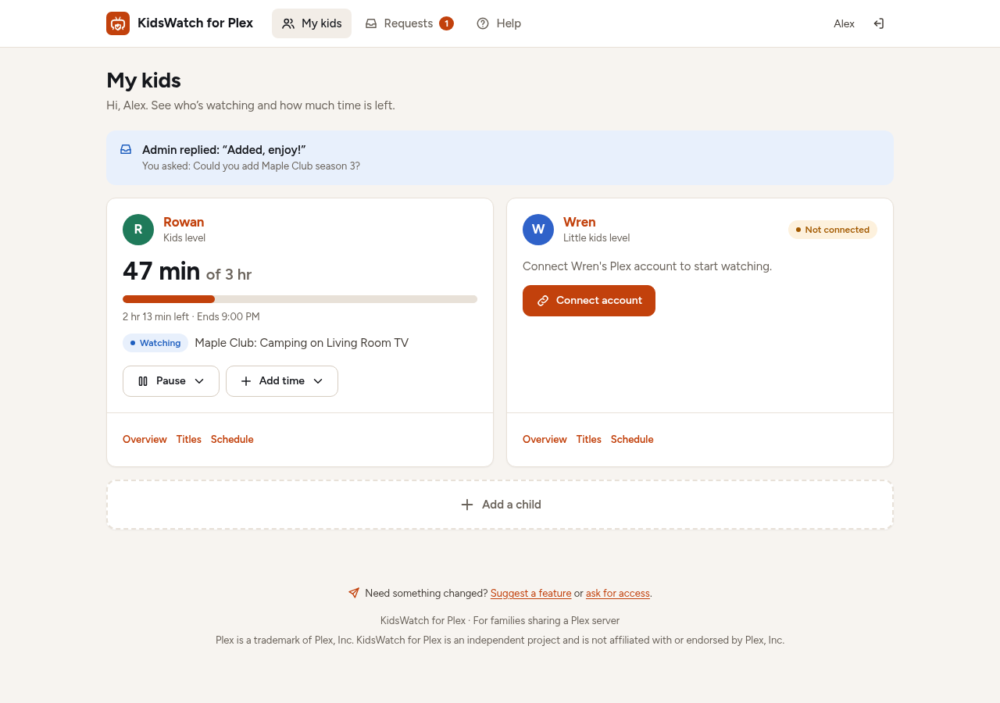
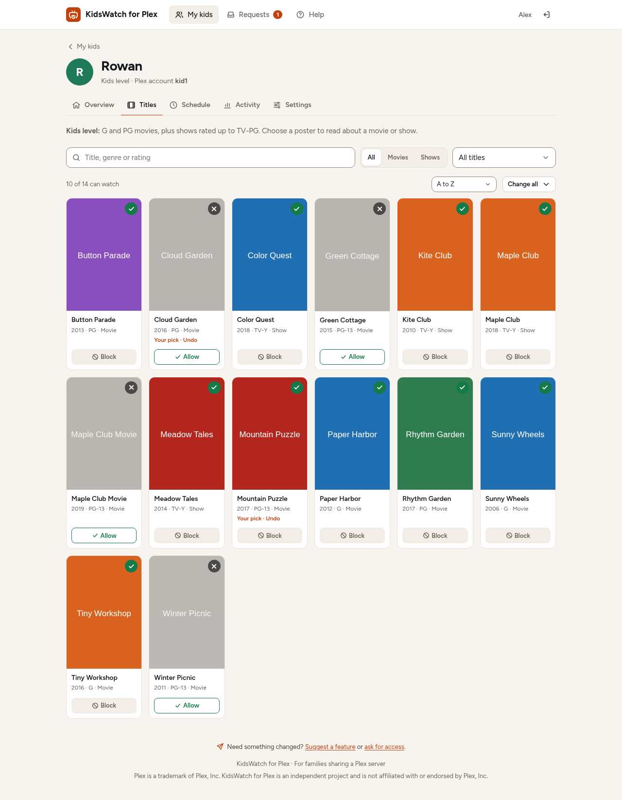
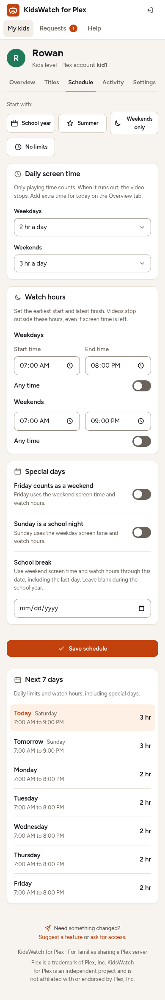
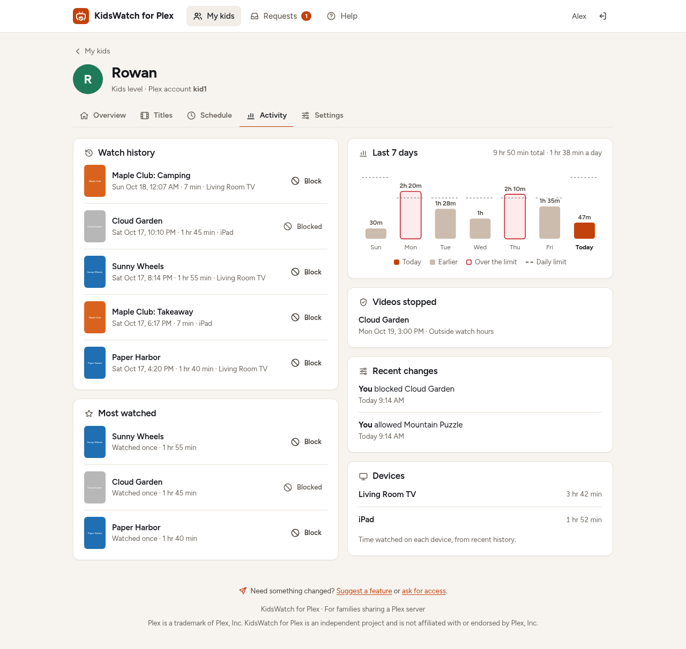
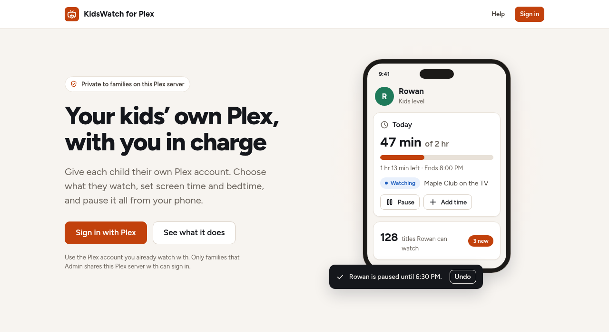
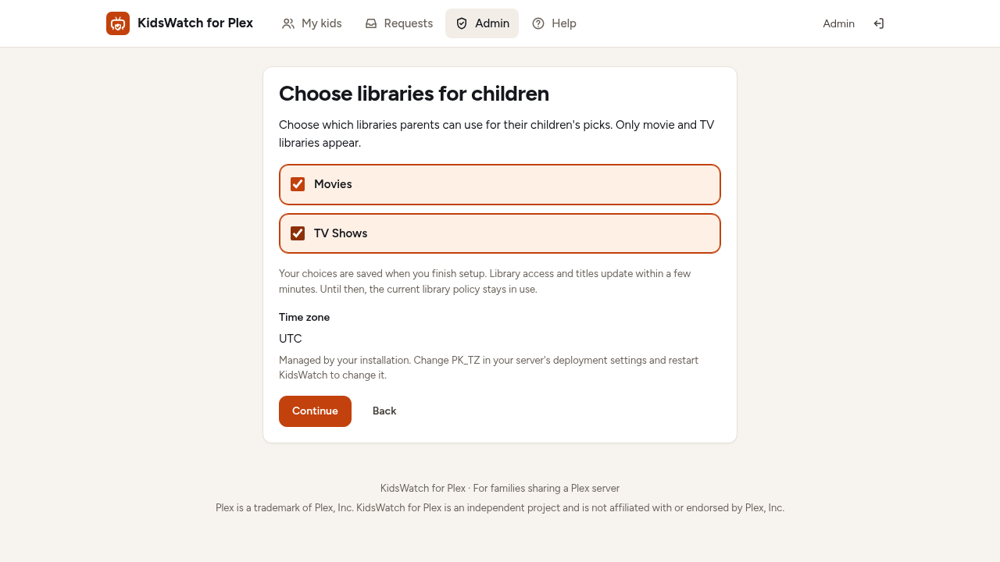
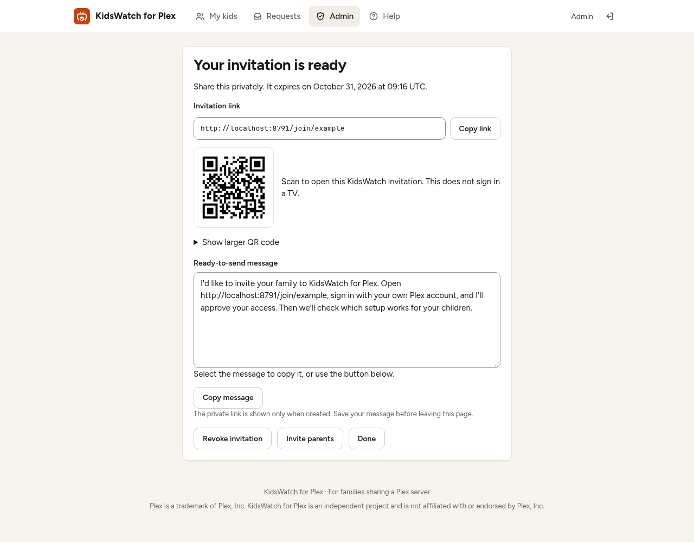
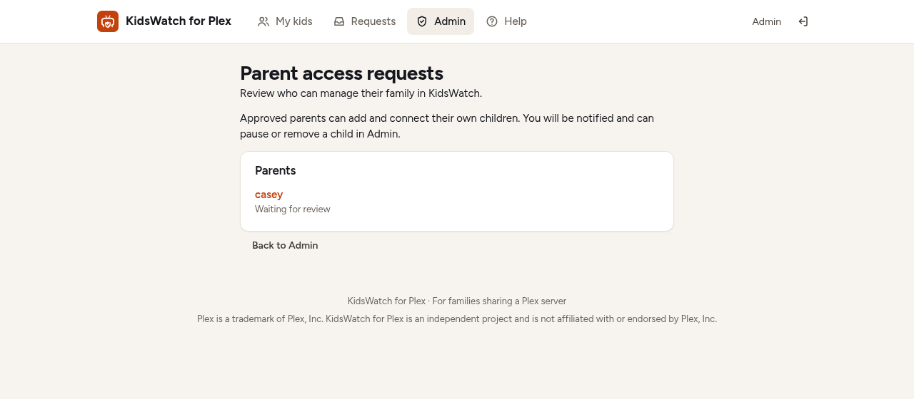
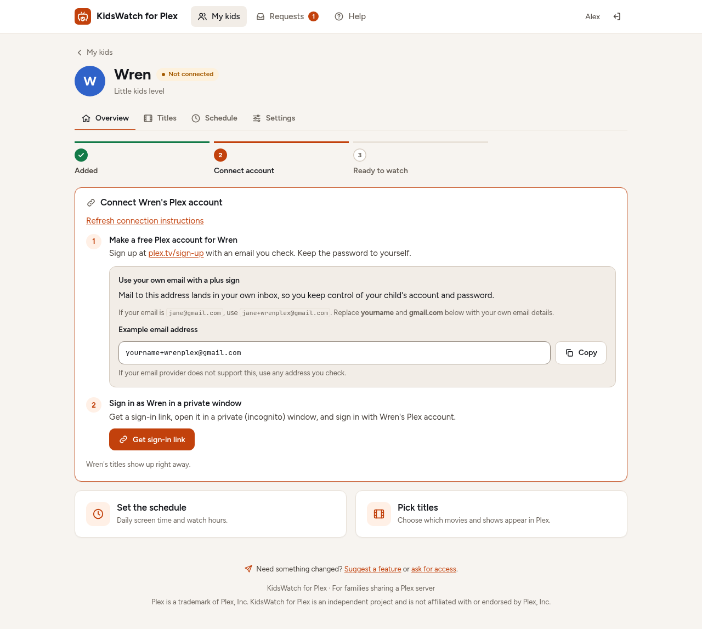

# KidsWatch for Plex

[Project home](https://kidswatchtv.com/plex/)

KidsWatch for Plex is a self-hosted website for families who share a Plex server.
Parents choose what each child can watch, set daily screen time and watch hours,
pause playback, and give extra time. The server owner approves parents and can
optionally require approval for each child. Parents can ask for titles and help through a built-in Requests form.

Plex is a trademark of Plex, Inc. KidsWatch for Plex is an independent project and is not affiliated with or endorsed by Plex, Inc.

## Android companion connection

The optional versioned mobile API and **Connect a phone / Connected phones** website pages are off by default (`PK_MOBILE_ENABLED=0`). Complete owner setup and use a valid root HTTPS address before enabling them in a reviewed installation. Phones connect with a private, two-minute, one-time code; media-server credentials stay on the server. The website remains supported on every phone, including iPhone.

See the [Android connection guide and assistant install prompt](docs/android-install.md), [server rollout and undo](docs/mobile-install.md), and [mobile API contract](docs/mobile-api.md). The server update does not publish or install an Android APK. Foreground polling requires no push provider; saved policy is distinct from observed playback stop.

## Screenshots

These screenshots use the local development server with fictional accounts and
titles. The invitation link and QR code are illustrative localhost examples.
Desktop views are 1280 pixels wide; the Schedule view is 390 pixels wide.

**Parent home:** see each child's screen time, pause playback, and add extra time.



<details>
<summary>See Titles, Schedule, Activity, sign-in, and family setup</summary>

**Titles:** review allowed and blocked titles, including your own picks.



**Schedule on a phone:** set daily screen time, watch hours, and special days.



**Activity:** review watch history, daily usage, stopped videos, and recent changes.



**Signed-out landing page:** introduce the app and sign in with Plex.



**Finish setup:** choose the movie and TV libraries available to families.



**Invite parents:** share a localhost example invitation by link or QR code.



**Parent approvals:** review a fictional parent's access request.



**Connect a child:** use the email tip when creating their Plex account.



</details>

## How it works

Parents sign in with their own Plex accounts. The server owner's account is the
admin. Only users who already share the server can request parent access; the
admin enables them. Each child needs a **free regular Plex account**, with an
email the parent controls. A managed Plex Home profile alone does not work.

A parent adds a child and connects the child's account through a one-time sign-in
link. With trusted parents enabled, verified connections activate immediately and
notify the owner; stricter mode keeps each child waiting for owner approval. The
app labels the exact titles allowed for each child and restricts that child's share to those labels. Parents can use an
age level, allow or block individual titles, or choose only explicitly allowed
titles. Downloads are disabled. During connection, the app tries to disable
Plex's own online movies and Live TV on the child's account and checks the result.

The screen-time keeper polls Plex sessions every 20 seconds by default. It counts
playing video and **ends playback sessions** when time runs out, watch hours end,
or a parent pauses watching. It does not block the player from opening or prevent
an immediate retry; a new session is stopped on a later poll. Music is not counted.

Plex settings, labels, sharing, and session controls are applied directly to your
server. The app reads the owner's token and server identifier from your existing
Plex `Preferences.xml`, mounted read-only. Its own SQLite database holds family
rules, usage, requests, and audit history. Plex library posters are fetched from
your server when signed-in users browse titles. The public tour ships only
original colored cards with fictional titles.

## Owner setup

Open **Admin > Owner setup**, sign in with the server owner's Plex account, and
complete the existing private sign-in code step. Choose movie and TV libraries,
send a test to the provisioned private notification receiver, and confirm receipt
before finishing. Saved libraries override `PK_KID_SECTIONS`; until setup finishes,
the environment remains the fallback. Receiver credentials stay in protected
server configuration and are never editable on these pages.

**Approved parents can add their own children** starts on for fresh installs.
Existing installs retain per-child approval until the owner enables it. Changes
apply to future connections: pending children still need review and active
children keep access. A trust change waits until any child connection finishes.
Setup does not verify playback stops; use the [live checklist](docs/live-checklist.md).

## Inviting parents

Open **Admin > Invite parents** and choose an adult who has already accepted your
Plex library invitation. Create a private link lasting 1, 7, or 30 days and share
its message or QR code. The recipient signs in with that invited Plex account,
then requests site access. The link does not grant access or sign in a TV.

Review the request in **Admin > Parent access requests** or open the authenticated
review page from its phone notification. Approval upgrades the parent's waiting
page without another sign-in. Links work once and can be revoked; a declined
request cannot be reopened by creating another invitation. The plus-address tip
on the regular child-account step uses the child's name and is only a suggestion
for an email address the parent controls.

## Requirements

- Docker Engine and a recent Docker Compose v2 with long-form bind mount support.
  Your login must have daemon access: check `docker version`. On a rootful Linux
  install that reports socket permission denied, use `sudo docker` for **every**
  Docker command below, including Compose. Never make the socket world-writable
  or mount it into this app. Docker group membership grants root-level access.
- Your own signed-in Plex Media Server, reachable from the app container, with
  movie or TV libraries that you are authorized to share.
- **Plex Pass on the server admin's account**, required for custom label/rating
  restrictions and for ending playback sessions. The app relies on both. See
  Plex's [restriction documentation](https://support.plex.tv/articles/204232573-restricting-the-shares/).
- A regular Plex account for each parent and child. Children do not need their
  own Plex Pass for this app's controls; Plex's separate remote-playback policies
  may impose additional requirements on the client or account.
- Read-only access to Plex's existing `Preferences.xml`, readable by container
  UID 1000. Do not put its contents in this repository or environment variables.
- An HTTPS reverse proxy and hostname for shared use. The example publishes the
  app only on the Docker host's loopback address.
- A private notification receiver for admin sign-in codes, or the protected
  authentication-proxy alternative described below. Home Assistant is optional.

Tautulli and an external media request site are optional and off by default.

## Quick start with Docker Compose

1. Download or clone this source and enter its directory. Copy the examples:

   ```sh
   cp docker-compose.example.yml docker-compose.yml
   cp .env.example .env
   sudo install -d -o 1000 -g 1000 -m 0700 data secrets
   ```

2. Edit `docker-compose.yml`: replace `/path/to/plex/Preferences.xml` with your
   existing file. Make it readable by UID 1000 and `data/` writable by UID 1000.
   See [Setup details](#setup-details) for file locations and permissions.

3. Edit `.env`: set your HTTPS `PK_PUBLIC_URL`, the `PK_PLEX_URL` reachable from
   the container, `PK_TZ`, and your movie/TV `PK_KID_SECTIONS` library keys.
   `localhost` means this container; `1,2` is only an example. The safe library
   listing command below prints the actual keys without displaying the token.

4. Set up [admin code delivery](#admin-code-delivery) and set
   `PK_HA_WEBHOOK_FILE=/run/secrets/notification_url`. Keep `PK_OWNER_CODE=1`.
   Admin sign-in is intentionally blocked until delivery is configured.

5. Run the app and configure [HTTPS with Caddy](#https-with-caddy):

   ```sh
   docker compose config --quiet
   docker compose up -d --build
   docker compose ps
   curl --fail http://127.0.0.1:8080/healthz
   curl --fail http://127.0.0.1:8080/readyz
   ```

   `/healthz` checks the web process only. `/readyz` returns 503 until Plex,
   libraries, and the keeper are ready; see the meanings below. A fresh install
   may need a few seconds for its first keeper tick. Keep port 8080 private and
   `PK_SECURE_COOKIES=1` for shared use.

6. Open your HTTPS site and sign in as the Plex server owner. Complete the code
   step, enable parents on Admin, then connect and approve a test child. Confirm
   its visible titles in Plex and **test a real playback stop** before relying on
   the limits. A passing readiness check cannot verify a player's stop behavior.

## Setup details

### Plex preferences and library keys

On Linux, `Preferences.xml` is usually under
`/var/lib/plexmediaserver/Library/Application Support/Plex Media Server/`.
For Docker, look in the host directory mapped to Plex's `/config`, under
`Library/Application Support/Plex Media Server/Preferences.xml`. NAS paths vary;
use Plex's [data-directory reference](https://support.plex.tv/articles/202915258-where-is-the-plex-media-server-data-directory-located/).
Use the existing file from your signed-in server. If it lives on another host,
arrange a secure read-only mount first. Never copy its contents into `.env`.

The app runs as UID/GID `1000:1000`, even if your login uses another UID. Give it
read access to the preferences file through ownership, a file ACL, or a dedicated
group added with Compose's `group_add`. Every parent directory must allow access.
Do not make the file world-readable. `data/` must be writable by UID 1000; `secrets/`
must be readable and searchable by it and writable only by its host owner.
All bind sources must already exist; the preferences source must be a file.

After starting the container, list libraries with this read-only command. It reads
the mounted preferences, sends credentials only in a header, and prints only
library keys, names, and types:

```sh
docker compose exec -T kidswatch python - <<'PYCODE'
from app.config import load
from app.plex import PlexClient, PlexError
p = PlexClient(load(), "setup-library-list")
try:
    for key, title in p.section_titles().items():
        print(key, title, p.section_type(key))
except PlexError:
    raise SystemExit("Cannot read Plex libraries. Check the mount, address, and server sign-in.")
PYCODE
```

For example, `4 Family Movies movie` and `7 Family TV show` mean set
`PK_KID_SECTIONS=4,7`. These are local library keys, not movie IDs or the cloud
sharing IDs. Select only `movie` and `show` libraries. Apply the change with
`docker compose up -d --force-recreate kidswatch`.

### HTTPS with Caddy

For Caddy installed **on the Docker host**, point a hostname you control at the
host and allow ports 80/443 for certificate issuance and HTTPS. Keep the app's
loopback port binding. Set `PK_PUBLIC_URL=https://kids.example.com` using your
real hostname. Add this block to `/etc/caddy/Caddyfile`:

```caddyfile
kids.example.com {
    reverse_proxy 127.0.0.1:8080 {
        header_up X-Forwarded-For {remote_host}
        header_up X-Forwarded-Proto {scheme}
        header_up -CF-Connecting-IP
        header_up -CF-IPCountry
    }
}
```

Back up an existing Caddyfile before editing, then run
`sudo caddy validate --config /etc/caddy/Caddyfile` and `sudo systemctl reload caddy`.
Caddy obtains HTTPS certificates automatically. This example assumes clients
connect directly to Caddy; configure trusted proxies separately if a CDN is in
front.

The app ignores `X-Forwarded-For` unless the connection comes from an address in
`PK_TRUSTED_PROXIES`, so visitors can't fake their address on a directly exposed
app. Behind a proxy, open the site once and run
`docker compose logs kidswatch | grep PK_TRUSTED_PROXIES`. The log line names the
proxy's address as the app sees it (with Caddy on the host this is the Compose
network gateway, such as `172.18.0.1`). Put that in `.env` as
`PK_TRUSTED_PROXIES=172.18.0.1` and recreate the container. Until then, every
visitor shares one sign-in rate limit. Set `PK_TRUST_CF_HEADERS=1` only when
Cloudflare sits in front of that proxy. See [Caddy's proxy documentation](https://caddyserver.com/docs/caddyfile/directives/reverse_proxy).
A containerized proxy needs a private shared Docker network and an upstream of
`kidswatch:8080`, with no public app port; its loopback cannot reach the host app.

### Health and troubleshooting

Docker's `/healthz` check reports web-process liveness, always HTTP 200 while the
app can serve requests. Its compatibility field `keeper` is `ok` after a recent
tick, `starting-or-stale` before one or after a long delay, or `disabled` when
`PK_START_ENFORCER=0`. An empty database can tick successfully without contacting
Plex, so `keeper: ok` alone does not establish Plex access.

`/readyz` makes a fresh authenticated request to Plex's local library endpoint
with a four-second timeout, even with no children. It returns HTTP 200 only when
`plex`, `libraries`, and `keeper` are all `ok`; otherwise it returns 503.
`plex: unavailable` means the server, credentials, or response could not be
verified. `libraries: invalid` means the selection is empty, missing, or includes
something other than movies/TV. Keeper values `disabled`, `starting-or-stale`, and
`error` mean the loop is off, has no recent successful running tick, or its last
tick failed. Responses contain no server addresses, tokens, or family details.
This checks local access and loop status, not plex.tv sign-in, share filters,
notification delivery, or whether playback can actually be stopped.

If startup says `PK_POLL_SECONDS must be a positive whole number of seconds (1 or
greater)`, replace values such as `0`, `-1`, or `fast` with `20` in `.env`, then run
`docker compose up -d --force-recreate kidswatch`. Read startup errors with
`docker compose logs --tail=50 kidswatch`; never include private settings in issue
reports. Plain `docker compose restart` reuses the old container environment.

#### Connection stuck / in progress

A child connection and changes to that child's access cannot run together.
HTTP 409 means a connection or account change is still running: wait for it to
finish, then retry Remove, Approve, Decline, a new connect link, or switching the
parent off. Claims do not expire automatically because a slow worker could still
create a Plex share.

If a crash leaves a claim stuck, stop **every** app worker/container first and
make a private, consistent SQLite backup. Compare that child's recorded Plex
account and `tracked_shares` entries with the actual shares in Plex, and revoke
any unexpected access directly in Plex. With all workers still stopped, clear
only that child's claim using SQLite, replacing `CHILD_ID` with its numeric ID:
`UPDATE kids SET connection_claim=NULL WHERE id=CHILD_ID;`. Restart the app, retry
Remove or cleanup if needed, and generate a new link if the child still needs
connecting. Never clear a claim while its connection worker might be running.
For immediate access removal, revoke the child's server share directly in Plex.

#### Plex outage

The app refreshes the parent sharing list after ten minutes and retries failed
reads after 30 seconds. During an outage it trusts the last successful list for
at most **30 minutes from the start of that read**. A parent removed from Plex
during this grace may retain site access until the next successful refresh or
the grace expires. After that, parent requests return HTTP 503 while retaining
their sessions, so access can recover without signing in again. New parent
sign-ins require a successful Plex read. This grace applies to site access;
playback enforcement still needs working Plex APIs. Stop all workers before
restoring/replacing SQLite, and restart them afterward; a sharing sequence
mismatch can also cause HTTP 503 until restart.

### Settings

Settings are read at startup by `app/config.py`. After editing `.env`, run
`docker compose up -d --force-recreate kidswatch` to recreate the container.
`docker compose restart` does not reload Compose environment files. The `PK_`
prefix is retained for compatibility with existing installations. Cookie names,
session-key derivation, database defaults, and Plex share-label identifiers also
remain compatible. The display name and Docker example use KidsWatch.

Defaults below are the application defaults, not required deployment values.
On/off switches take `1` or `0` (`true`/`false`, `yes`/`no` and `on`/`off` also work).
A blank value keeps the default, and anything else stops startup.

| Variable | Default | Meaning |
|---|---|---|
| `PK_PUBLIC_URL` | `http://localhost:8080` | Browser-facing URL for sign-in, child links, and notifications. Use your HTTPS URL. |
| `PK_PLEX_PREFS` | `/plex-prefs/Preferences.xml` | Container path to the read-only existing Plex settings file. |
| `PK_PLEX_URL` | `http://plex-host:32400` | Plex Media Server URL reachable from the container. |
| `PK_TAUTULLI_URL` | Empty | Optional Tautulli base URL reachable from the container. |
| `PK_TAUTULLI_CONFIG` | Empty | Container path to its read-only `config.ini`; required with its URL. |
| `PK_DB` | `/data/plexkids.db` | SQLite database path; its directory must be writable by UID 1000. |
| `PK_TZ` | `UTC` | IANA time zone used for schedules, days, and usage. Set this before adding children. |
| `PK_HA_WEBHOOK_FILE` | Empty | Path to a protected file containing the notification receiver URL. No Home Assistant dependency is required. |
| `PK_POLL_SECONDS` | `20` | Positive whole seconds between session checks. Longer intervals delay stops. |
| `PK_SEED_PARENTS` | Empty | Comma-separated Plex usernames to enable at first sign-in, only if they already share your server. |
| `PK_KID_SECTIONS` | `1,2` | Comma-separated movie/TV library keys children may use; check your own server. |
| `PK_SECURE_COOKIES` | `1` | Require HTTPS for the session cookie and send HSTS. Keep `1` for HTTPS/public instances. Use `0` only for isolated development or a separately configured, explicitly selected direct HTTP LAN-only instance; browser cookies, codes, and bearer traffic are unencrypted, with no public/tunnel/proxy exposure. See the [LAN prerequisites](docs/android-install.md#make-the-server-reachable). |
| `PK_OWNER_NAME` | `Admin` | Public display name of the server owner in help, requests, and approval messages. Does not choose the admin account. |
| `PK_APP_NAME` | Empty | Optional app name in the shared page header, default page title, installation title, and manifest. Plain text, trimmed to 80 characters. Empty keeps the existing branding. |
| `PK_FOOTER_TEXT` | Empty | Optional footer line, plain text trimmed to 240 characters. The separate Plex trademark disclaimer always remains. |
| `PK_LANDING_ART_DIR` | Empty | Optional read-only owner poster directory with `art.json`. Invalid entries use bundled art. See [owner artwork](docs/owner-branding.md). |
| `PK_START_ENFORCER` | `1` | Run the time keeper and periodic share/title synchronization. Leave enabled in production. |
| `PK_OWNER_CODE` | `1` | Require the admin's additional six-digit sign-in code. Missing code delivery blocks sign-in. |
| `PK_MEDIA_REQUEST_URL` | Empty | Optional HTTP(S) URL for your request site. Empty keeps title requests in the built-in Requests form. Prefer HTTPS. |
| `PK_TRUSTED_PROXIES` | Empty | Comma-separated reverse proxy addresses or ranges whose `X-Forwarded-For` is believed. Empty uses each connection's own address. |
| `PK_TRUST_CF_HEADERS` | `0` | Use `CF-Connecting-IP` and `CF-IPCountry`, only when they arrive through a trusted proxy. |

### Admin code delivery

The receiver accepts a JSON POST with `title`, `message`, and `url`. The `message`
contains the sign-in code; `url` links back to the app. A configured URL also
receives requests and enforcement alerts, so protect the receiving account and
avoid shared notification channels. The URL is a credential; keep it in your
password manager and provide it at runtime in a protected file, never in `.env`,
Compose, logs, or source control. Provision `secrets/notification_url` from that
manager with owner UID/GID 1000 and mode `0600`; do not enter the URL in shell
history. It is exposed read-only as `/run/secrets/notification_url`.

**Home Assistant starter recipe:** install its Companion App on the admin's
phone and confirm its private `notify.mobile_app_...` action works. Then:

1. In **Settings > Automations & scenes**, create a new automation. Add a
   **Webhook** trigger; keep its randomly generated ID private and allow only
   **POST**. Keep **Local only** enabled and ensure the app can reach HA through
   your private network. The receiver URL is your HA base URL plus
   `/api/webhook/` and that generated ID.
2. Add a **Notifications: Send a notification via mobile_app_...** action for the
   admin's phone. Set **Title** to `{{ trigger.json.title }}`, **Message** to
   `{{ trigger.json.message }}`, and the optional **Data** to
   `url: "{{ trigger.json.url }}"`. Save and enable the automation. Use the
   [webhook documentation](https://www.home-assistant.io/docs/automation/trigger/#webhook-trigger)
   if your editor labels differ. HA automation traces contain payloads; restrict
   admin access and set stored traces to 0 in the automation's YAML editor with
   `trace: {stored_traces: 0}`.
3. Provision the complete URL as `secrets/notification_url` from your password
   manager, not a command argument. Check its access without printing it:
   `sudo stat -c '%u:%g %a' secrets/notification_url` should show `1000:1000 600`.
   Set `PK_HA_WEBHOOK_FILE=/run/secrets/notification_url` and run
   `docker compose up -d --force-recreate kidswatch`.
4. Test from the actual container with the command below, and verify the phone
   receives **KidsWatch delivery test**. Then sign in normally to check code
   delivery. A successful HTTP response alone does not prove phone delivery.

```sh
docker compose exec -T kidswatch python - <<'PYCODE'
from pathlib import Path
import httpx
from app.config import load
cfg = load()
try:
    url = Path(cfg.ha_webhook_file).read_text().strip()
    response = httpx.post(url, json={"title": "KidsWatch delivery test",
        "message": "Test notification only. No sign-in code.",
        "url": cfg.public_url + "/admin"}, timeout=10)
    response.raise_for_status()
except Exception:
    raise SystemExit("Delivery request failed. Check the private receiver and file permissions.")
print("Request accepted. Confirm the notification arrived on the admin phone.")
PYCODE
```

Use HTTPS, or an isolated private network for the receiver. Do not publish the
webhook or send codes to a shared channel.

**Fallback without Home Assistant:** use any private notification receiver that
accepts the same JSON and delivers the code to a separately authenticated admin
device or account. Keep `PK_OWNER_CODE=1`. No code is returned in the browser or
written to application logs. Codes expire after five minutes and allow five
wrong attempts; pending codes are lost when the app restarts.

**Recovery if delivery is broken:** keep the code requirement on and restore the
receiver using the Docker host console, then apply any `.env` changes with
`docker compose up -d --force-recreate kidswatch` and repeat the delivery test.
As an advanced alternative, deploy an authentication proxy that requires its own
second factor on **every app route**,
verify the app cannot be reached around that proxy, and only then explicitly set
`PK_OWNER_CODE=0`. This opts out of the app's code step, so the proxy must supply
that protection. Keep the loopback binding, HTTPS, and secure cookies. Do not
turn off the code step on an otherwise exposed site merely to get signed in.

### Optional watch history with Tautulli

Set both `PK_TAUTULLI_URL` and `PK_TAUTULLI_CONFIG=/tautulli/config.ini`, and
uncomment the read-only Tautulli bind mount in Compose. Make the file readable
by UID 1000 without making it public. The app reads `[General] api_key` in place;
keep Tautulli on a private network or use HTTPS because its API key travels in
request parameters. This service is not needed for time counting or stopping
playback. Without it, history panels show an unavailable message; local usage
charts and recorded stops still work. History is cached for a minute, with up to
an hour of stale history during a later API outage.

### Optional request site

Set `PK_MEDIA_REQUEST_URL` only if you operate a compatible request site, such as
Seerr or Overseerr, for example. The app links to your request site and appends `/search` for
search links. It does not install that service, configure downloads, or transfer
credentials. The site's authentication and automation are your responsibility.
Leave the setting empty to use the built-in Requests form, where the admin
manually answers and fulfills requests.

## Security notes

- Treat the app as a Plex server administration tool. Its read-only Plex mount
  contains a powerful owner token; read-only prevents file edits, not API actions.
- The session signing key is derived from the owner token. No separate signing
  secret is required. Rotate the Plex token **and restart the app** to invalidate
  existing session cookies; the signing key is derived only at startup. Use
  Admin's sign-everyone-out control for immediate session revocation.
- Keep the database, backups, and notification URL private. The database contains
  child names, linked account details, requests, and watch activity. Parent tokens
  are discarded after sign-in; child connection tokens are used briefly, not saved.
- The app uses CSRF checks, limited request bodies, strict content security
  headers, secure cookies by default, and restricted parent access. These do not
  replace a trusted reverse proxy or host security.
- Forwarded client addresses are used only from `PK_TRUSTED_PROXIES`, taking the
  last `X-Forwarded-For` entry that isn't one of those proxies. `CF-Connecting-IP`
  and `CF-IPCountry` also need `PK_TRUST_CF_HEADERS=1`. No tunnel vendor is
  required by the app.
- Sign-ins are recorded on the server. Signing out ends that sign-in everywhere
  its cookie was copied. Admin sign-ins end after 12 idle hours or 7 days; parent
  sign-ins after 14 idle days or 30 days. Updating from an older version asks
  everyone to sign in once more.
- A phished Plex sign-in can grant a parent's role. Open your own site directly
  before starting sign-in, and do not follow unsolicited authentication links.
- Report vulnerabilities as described in [SECURITY.md](SECURITY.md).

## Limitations

- Controls follow the child's regular account. Using a parent's account bypasses
  them. Protect parent accounts and Plex Home profiles with appropriate PINs.
- Stopping sessions depends on the running app, working Plex APIs, network access,
  supported clients, and Plex Pass. Stops are polled, not instantaneous. The app
  does not filter content played outside your server or control offline copies.
- Concurrent sessions for one child count elapsed time once while any video is
  playing. Paused playback and music do not count. Usage can be incomplete during
  outages.
- Allowed titles are synchronized about every five minutes; the library cache can
  delay newly added titles by about ten more minutes. New titles stay hidden until
  the child's allowed label is applied. Check sync errors before relying on rules.
- Age levels use supported rating strings and cap explicit picks at PG-13/TV-14.
  Unrated and adult titles stay hidden. Bad source ratings still need human review.
- Plex's sharing and online-source APIs can change. The app retries rejected share
  settings, but you may need to review shares directly in Plex. Check that online
  sources really are disabled on every child account.
- Use one application process and one container per database. Sign-in codes,
  rate limits, caches, and the enforcement thread are process-local. Do not add
  workers or scale replicas without redesigning those parts.
- Changing the time zone after use can split daily usage across different dates.
- The example requires you to supply your own Plex server, HTTPS proxy, and code
  delivery. It is not a bundled Plex installation.

## Updates, backup, and removal

Before updating, stop the service and make a private, consistent backup of `data/`
and your configuration. Keep the previous image and source revision. Protect
backups with the same permissions as the live database. Build the new image,
run `docker compose up -d --build`, and check `/healthz`, `/readyz`, title filters,
and a real playback stop. Apply `.env` changes by recreating the container as above.

To roll back, stop the service, restore the previous source and image, and restore
the matching database backup with owner UID/GID 1000 before starting again. Do not
assume an older app can read a newer database schema. `docker compose down` stops
the app but does not remove its shares or labels from Plex.

Before uninstalling, review and then explicitly remove the app-managed shares:

```sh
docker compose exec kidswatch python -m app.cleanup
docker compose exec kidswatch python -m app.cleanup --apply
```

The second command removes each tracked child's share and labels. Review the list
and take a private backup first. Then stop the service and remove its local files
when you no longer need them.

## Holding site

The static holding page lives in `site/`. Preview it locally with
`python3 -m http.server 8000 --bind 127.0.0.1 --directory site` and open
`http://127.0.0.1:8000`. The production host applies `site/_headers`.

## Development and licenses

Use Python 3.12 or later and install `requirements.txt` plus
`requirements-dev.txt` into your own virtual environment. Run:

```sh
python -m pytest -q
python -m tests.dev_server
```

The development server uses fictional accounts and bypasses authentication at
`http://127.0.0.1:8791/dev-login?u=alex&next=/home` or
`http://127.0.0.1:8791/dev-login?u=owner&next=/admin`. It binds only to loopback.
Never deploy it or expose its authentication bypass to a network.
`tools/check_layout.mjs` is an optional local Chromium layout check.

Application code and original title cards use the [MIT license](LICENSE).
The bundled Figtree font is separately distributed under the
[SIL Open Font License 1.1](app/static/fonts/OFL-Figtree.txt), with its upstream
copyright and license included beside the font. The original TV-with-check-mark
logo is retained.
